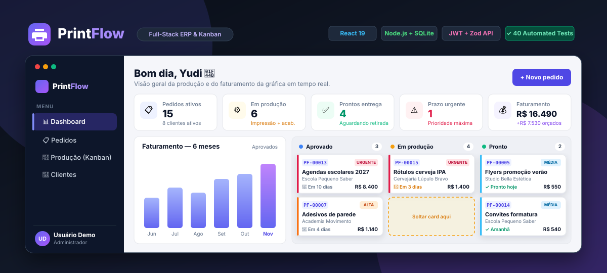

<div align="center">

  

  <h1>🖨️ PrintFlow — Gestão de Pedidos & Produção para Gráficas</h1>
  <p><strong>Aplicação Full-Stack completa (React 19 + Node.js + SQLite) para controle comercial e operacional de gráficas, do orçamento à entrega final em quadro Kanban interativo.</strong></p>

  <p>
    
    
    
    
    
    
    
  </p>

</div>

---

## 🎯 Visão Geral do Projeto

O **PrintFlow** foi projetado com arquitetura limpa em monorepo (`workspaces`) para resolver o fluxo real de uma gráfica rápida ou offset: controlar orçamentos, carteira de clientes, prazos de entrega, gargalos de produção/acabamento e faturamento mensal em uma única interface rápida e responsiva.

### ✨ Destaques de Engenharia & Produto

- **🔐 Autenticação JWT & Controle de Perfis (`admin` / `operador`)** — Cadastro, login com `bcryptjs`, validação de token via middleware, persistência de sessão e botão de preenchimento rápido da conta de demonstração.
- **📊 Dashboard Analítico em Tempo Real** — KPIs de pedidos ativos, em produção, prontos para entrega, atrasados e faturamento do mês; gráfico de barras dos últimos 6 meses; barra empilhada de distribuição por etapa; próximas entregas e ranking de top clientes.
- **📌 Quadro Kanban com Drag & Drop Nativo** — 6 etapas (`Orçamento`, `Aprovado`, `Em produção`, `Acabamento`, `Pronto`, `Entregue`) com arrastar e soltar, atualização otimista no front-end, reindexação transacional de posições no banco e soma financeira por coluna.
- **📋 Gestão Completa de Pedidos & Auditoria** — Geração automática de código sequencial (`PF-00001`), coluna calculada `total_cents` no SQLite, filtros combinados (busca textual, status, prioridade e atrasados), *stepper* interativo de avanço de etapa e linha do tempo (`order_history`) registrando quem moveu e quando.
- **👥 Carteira de Clientes (CRUD)** — Busca instantânea com *debounce*, contagem de pedidos, volume total contratado (R$) e proteção de integridade referencial que bloqueia a exclusão de clientes com pedidos vinculados.
- **🗄️ Banco de Dados SQLite Nativo (`node:sqlite`)** — Zero dependências nativas C++ externas, *foreign keys* ativas, modo `WAL`, índices de performance e transações ACID.
- **🧪 40 Testes Automatizados** — 25 testes de integração na API REST (`node:test` + Supertest em banco `:memory:` isolado) + 15 testes de unidade e interface no Front-end (Vitest + React Testing Library).

---

## 🛠️ Arquitetura & Tecnologias

| Camada | Tecnologias & Padrões |
| :--- | :--- |
| **Front-end (`client/`)** | React 19, Vite 8, React Router, Context API (`AuthContext`, `ToastContext`), Lucide Icons, Design System CSS próprio |
| **Back-end (`server/`)** | Node.js (ESM), Express 5, SQLite (`node:sqlite`), Zod (validação de schemas), JSON Web Token (`jsonwebtoken`), `bcryptjs` |
| **Qualidade & Testes** | Node.js Test Runner (`node:test`), Supertest, Vitest, React Testing Library, JSDOM |

---

## 🚀 Como Executar Localmente

### Pré-requisitos
- **Node.js 22.13+** instalado (`node -v`)

### 1. Clonar o repositório e instalar dependências
```bash
git clone https://github.com/yudizy7/printflow.git
cd printflow
npm install
```

### 2. Popular o banco com dados de demonstração
```bash
npm run seed
```
Cria automaticamente **8 clientes**, **22 pedidos realistas de gráfica** distribuídos nas etapas do Kanban e a conta de demonstração:
- **E-mail:** `demo@printflow.com`
- **Senha:** `demo123`

### 3. Iniciar em modo de desenvolvimento
```bash
npm run dev
```
- **Aplicação Web (React + Vite):** `http://localhost:5173`
- **API REST (Express):** `http://localhost:3333/api/health`

---

## 🧪 Executando a Suíte de Testes

```bash
# Roda todos os 40 testes (Back-end + Front-end)
npm test

# Ou separadamente por workspace:
npm test -w server   # 25 testes de integração da API REST
npm test -w client   # 15 testes unitários e de componentes React
```

---

## 🔌 Principais Endpoints da API REST

| Método | Rota | Descrição |
| :---: | :--- | :--- |
| `POST` | `/api/auth/register` | Cadastra usuário (1º usuário recebe papel `admin`) e retorna JWT |
| `POST` | `/api/auth/login` | Autentica credenciais e retorna `{ token, user }` |
| `GET` | `/api/auth/me` | Retorna dados do usuário autenticado pelo header `Bearer` |
| `GET` | `/api/dashboard` | KPIs, faturamento dos últimos 6 meses, próximas entregas e top clientes |
| `GET / POST` | `/api/clients` | Lista/busca clientes (`?q=`) com total faturado ou cadastra novo cliente |
| `GET / PUT / DELETE` | `/api/clients/:id` | Detalhes com pedidos do cliente, atualização ou exclusão segura |
| `GET / POST` | `/api/orders` | Lista pedidos com filtros (`status`, `priority`, `q`, `overdue`) ou cria pedido |
| `GET / PUT / DELETE` | `/api/orders/:id` | Detalhes do pedido + linha do tempo `history`, edição ou exclusão |
| `PATCH` | `/api/orders/:id/move` | Move e reordena card no Kanban dentro de transação ACID |

---

## 🗂️ Estrutura do Repositório

```text
printflow/
├── docs/
│   └── preview.svg               # Preview visual do Dashboard e Quadro Kanban
├── package.json                  # Workspaces (server + client) e scripts unificados
├── server/                       # API REST Node.js + Express 5 + SQLite
│   ├── src/
│   │   ├── app.js                # Configuração Express, CORS e rotas
│   │   ├── db.js                 # Schema SQLite, índices, WAL e transações
│   │   ├── validation.js         # Schemas Zod de validação e normalização
│   │   ├── seed-data.js          # Dados realistas de gráfica para demonstração
│   │   ├── middleware/auth.js    # Geração e verificação de token JWT
│   │   └── routes/               # auth.js, clients.js, orders.js, dashboard.js
│   └── tests/                    # 25 testes de integração com Supertest
└── client/                       # SPA React 19 + Vite
    └── src/
        ├── components/           # Layout, Modal, Badges, ClientFormModal, OrderFormModal
        ├── context/              # AuthContext e ToastContext
        ├── lib/                  # Cliente HTTP, formatação BRL/prazos e motor Kanban
        ├── pages/                # Login, Register, Dashboard, Orders, OrderDetail, Kanban, Clients
        └── test/                 # 15 testes com Vitest + Testing Library
```

---

<div align="center">
  <sub>Desenvolvido por <a href="https://github.com/yudizy7"><strong>Yudi (@yudizy7)</strong></a> • Licença MIT</sub>
</div>
